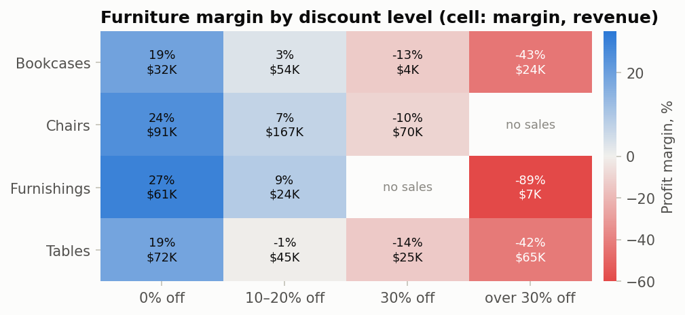
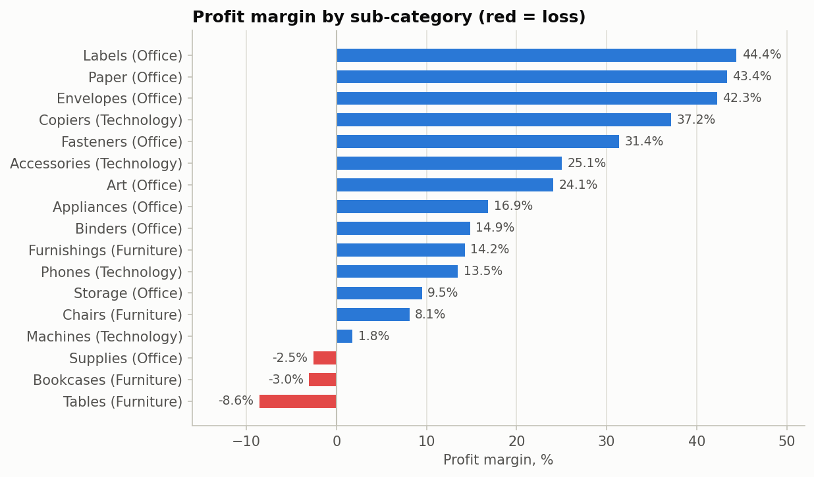

# Superstore Sales Analysis

Where does a US office-supply retailer make and lose money, and what should it change? Analysis of 9,994 order lines (5,009 orders, 2014–2017) from the Sample Superstore dataset (Kaggle).

## Key findings

- Revenue grew **51%** from 2014 ($484K) to 2017 ($733K). Technology leads in revenue ($836K) and profit ($145K).
- **Furniture** is #2 by revenue ($742K) but earns a **2.5% margin**, against 17% for the other two categories.
- **The cause is deep discounting.** Furniture deals discounted more than 20% are 26% of the category's revenue and lost **$54K**, three times its entire profit. Every Furniture sub-category is profitable without a discount (18–27% margin) and loses money beyond 20%.
- The losses concentrate in **Tables and Bookcases** ($42K of the $54K) and in **Texas, Illinois, Pennsylvania and Ohio**. In Texas and Illinois, every Furniture sale carried a discount above 20%.
- **Discounts do not lift volume:** units per order line are the same with and without a discount (Spearman ρ = −0.007, p = 0.74). The margin gap between deals at ≤20% and >20% off is 41 percentage points (95% bootstrap CI 38–44, resampling whole orders).
- September, November and December are the top three months every year and bring 43% of revenue. West leads the regions ($725K); New York City is the top city ($256K).



## Recommendation

1. **Cap Furniture discounts at 20%**, starting with Tables and Bookcases.
2. **Review the blanket discount policy** in Texas, Illinois, Pennsylvania and Ohio.
3. **Roll it out as an A/B test.** The data shows discounts do not raise units per line, but not whether they bring in orders that would not happen otherwise. Apply the cap in a random half of the affected states for a quarter and compare orders, revenue and profit.

On historical data, Furniture's margin on deals discounted 20% or less is **13.3%**, against 2.5% overall. That figure assumes the deeper-discounted deals would simply disappear, which is why the test comes first.



## Notebook

[`notebooks/01_sales_analysis.ipynb`](notebooks/01_sales_analysis.ipynb): data checks, category and trend overview, seasonality, regions and cities, sub-category margins, the discount root-cause analysis, statistical checks (Spearman, Mann–Whitney U, order-level bootstrap), recommendation.

```bash
git clone https://github.com/Reckaba/sales-analysis
cd sales-analysis
pip install -r requirements.txt
jupyter notebook notebooks/01_sales_analysis.ipynb
```

## Tech stack

Python · pandas · NumPy · SciPy · matplotlib · Jupyter
